<div align="center">

# ✦ Luma

**A high-performance, SDF-based hybrid world-space UI framework for the Bevy game engine.**

[](https://crates.io/crates/bevy_luma)
[](https://docs.rs/bevy_luma)
[](https://bevyengine.org)
[](#license)

<br/>

<p align="center">
  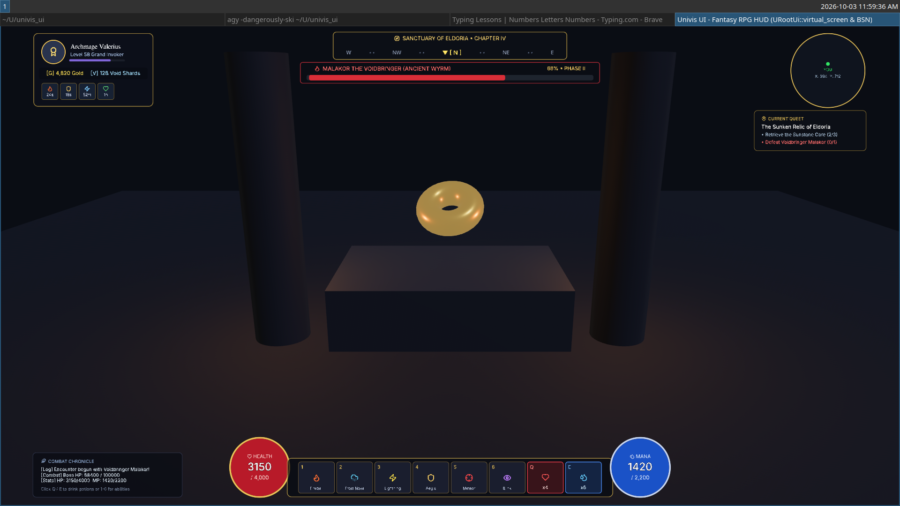
</p>

</div>

---

## ✨ Features

- 💎 **Pure GPU Signed Distance Field (SDF) Rendering**:
  - Pixel-perfect, anti-aliased rounded corners (`UCornerRadius`), dynamic borders (`UBorder`), and box shadows (`UShadow`).
  - Real-time inner and outer holographic glows (`UGlow`) rendered in optimized shader passes.
  - Zero-cost resolution scaling: crisp at 720p, 4K, or in VR headsets.

- 📐 **High-Performance Native Layout Engine (`luma_layout`)**:
  - Independent, zero-dependency layout engine written in pure Rust.
  - Full support for **Flexbox**, **CSS Grid** (fractional units `Fr`, `Auto`, repeats), **Absolute**, and **Radial** layouts.
  - Dual-buffer topological pass (pass-up for intrinsic measurement, pass-down for bounded positioning) caching in flat arenas with zero runtime allocations.

- 🌐 **Seamless 2D & 3D Spatial UI**:
  - **Screen Space**: `URootUi::screen()` and `URootUi::virtual_screen(Vec2::new(1920.0, 1080.0))` for deterministic game HUDs.
  - **In-World 3D**: `URootUi::world_3d()` for physical, diegetic terminals, VR panels, and interactive sci-fi kiosks.
  - Unified component model: identical APIs for both 2D and 3D UI.

- 🔤 **Embedded Multi-Script Typography & Vector Icons**:
  - Embedded high-legibility fonts: **Inter**, **Adwaita Sans**, **Fira Sans**, and **FreeSerif**.
  - Full Arabic and RTL bidirectional shaping powered by `unicode-bidi` and `swash`.
  - Built-in **Lucide** vector icon library with over 1,400 icons available out of the box (`Icon::PLAY`, `Icon::SEARCH`, `Icon::SHOPPING_BAG`, etc.).

- 🎯 **Spatial Focus Navigation & Pointer Interaction**:
  - First-class pointer picking backend (`UInteraction`, `UInteractionColors`).
  - Spatial directional navigation (Tab, Arrow keys, Gamepad D-Pad/sticks) via `UFocusable` and `UFocusVisual`.
  - Interactive text fields with caret animation, clipboard, and input filtering (`UTextInput`).

- 🌊 **Spring Transitions & Kinetic Momentum**:
  - Configurable spring physics (`UTransition`) for responsive hover, accordion collapses, and scale bumps.
  - Inertial kinetic scrolling containers (`UScrollContainer`) with customizable scrollbars.

---

## 📸 Showcase & Examples

| Cloud Analytics Dashboard | Nordic Boutique Store (CSS Grid) |
| :---: | :---: |
|  | 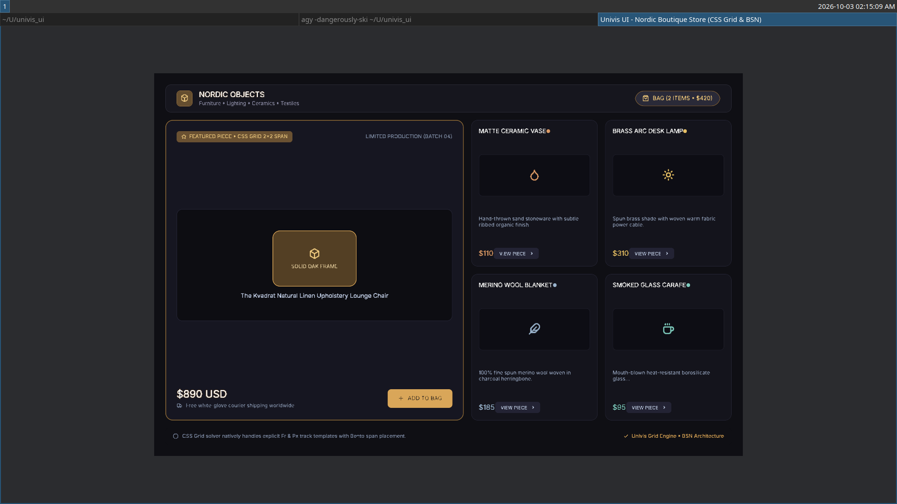 |
| `cargo run --example luma_flex_dashboard` | `cargo run --example luma_grid_ecommerce` |

| Creative Studio Palette (Visual SDF) | Music Streaming Player (Stack Layout) |
| :---: | :---: |
| 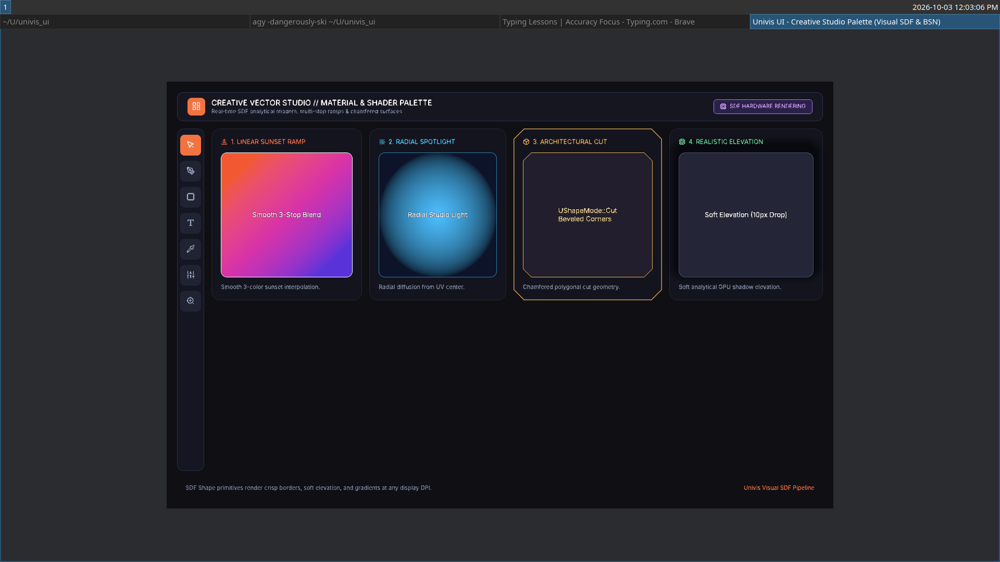 | 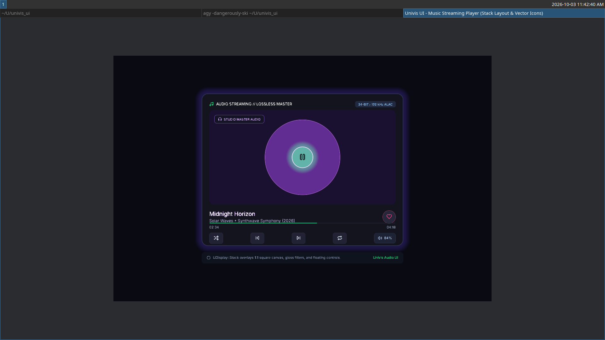 |
| `cargo run --example luma_visual_creative_studio` | `cargo run --example luma_stack_music_player` |

| Museum Kiosk (3D In-World Space) | Fintech Banking (Pointer Interactions) |
| :---: | :---: |
| 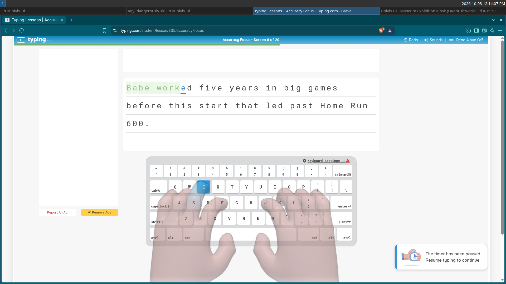 | 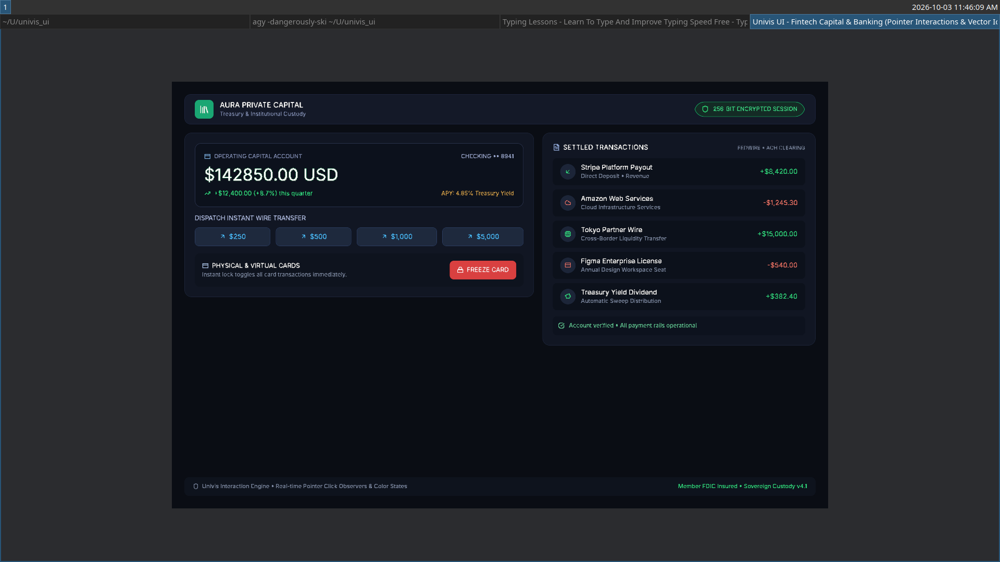 |
| `cargo run --example luma_world_3d_gallery` | `cargo run --example luma_interaction_banking` |

| Editorial Magazine (Multi-Script & Arabic) | Rich Typography & Outlines Studio |
| :---: | :---: |
| 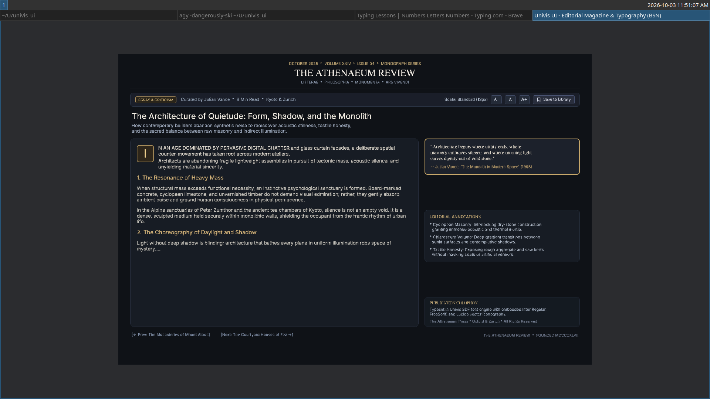 | 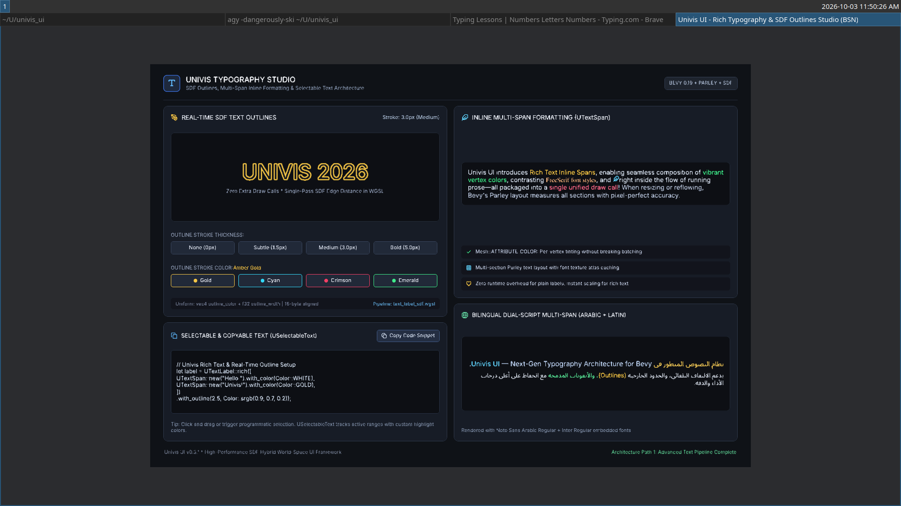 |
| `cargo run --example luma_editorial_typography` | `cargo run --example luma_rich_typography` |

| Team Feed (Kinetic Scroll Container) | Knowledge Base (Spring FAQ Accordion) |
| :---: | :---: |
| 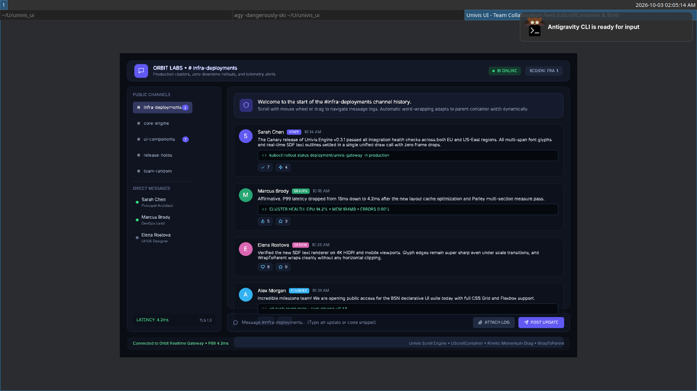 | 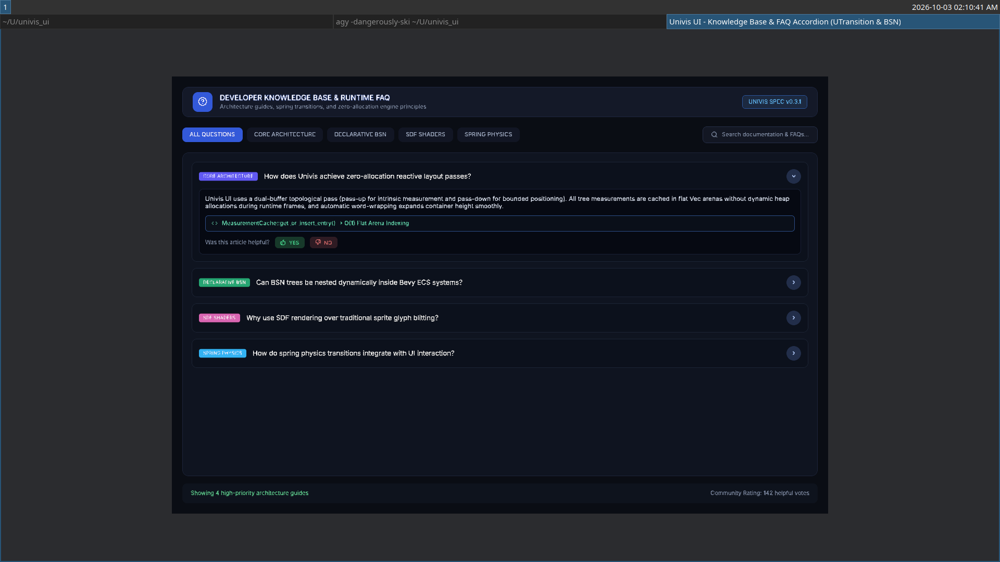 |
| `cargo run --example luma_scroll_social_feed` | `cargo run --example luma_spring_faq_accordion` |

| Game Settings (Focus & Gamepad Nav) | Developer Settings (Forms & Text Inputs) |
| :---: | :---: |
| 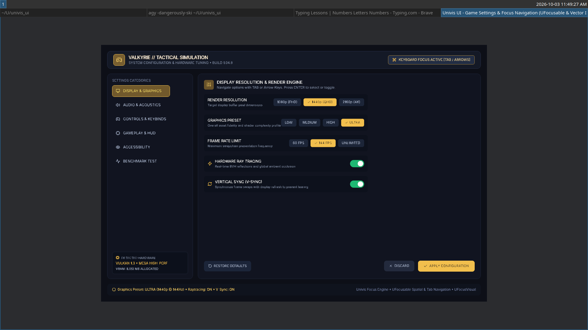 | 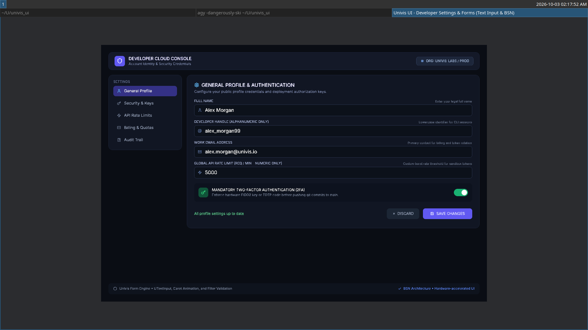 |
| `cargo run --example luma_focus_game_menu` | `cargo run --example luma_form_profile` |

---

> 📘 **New to Luma? Check out the [Developer Handbook & Practical Guide](docs/GUIDE.md)** for copy-paste recipes (modals, navbars, 3-column grids), cheat sheets, and troubleshooting tips so you never get stuck!

---

## 🧭 The 5-Minute Mental Model

Luma is designed to feel natural and predictable. Every interface follows three simple building blocks:

```
[Camera2d or Camera3d]
       │
[URootUi] ─── The Canvas (Screen HUD, Virtual Resolution, or 3D World Space)
       │
    [UNode] ─── The Box (Sizing, Flexbox/Grid, Rounded Corners, Borders, Shadows)
       │
    ├── [UText]  ─── Typography (Latin, Arabic, Serif) and Lucide Icons
    └── [UNode]  ─── Child containers, buttons, cards, scroll views...
```

1. **Always spawn a Camera** (`Camera2d` for screens, `Camera3d` for in-world UI).
2. **Every tree starts with a Root** (`URootUi::screen()` or `URootUi::world_3d()`).
3. **Nodes flow naturally** via standard Flexbox or CSS Grid.

---

## 🚀 Quick Start

Add `bevy_luma` to your `Cargo.toml`:

```toml
[dependencies]
bevy = "0.19"
bevy_luma = "0.1.0"
```

### Minimal Hello World

```rust
use bevy::prelude::*;
use bevy_luma::prelude::*;

fn main() {
    App::new()
        .add_plugins(DefaultPlugins)
        .add_plugins(LumaPlugin)
        .add_systems(Startup, setup_ui)
        .run();
}

fn setup_ui(mut commands: Commands, theme: Res<Theme>) {
    // 2D Camera
    commands.spawn(Camera2d);

    // Screen-space UI Root
    commands
        .spawn((
            URootUi::screen(),
            UNode {
                width: UVal::Percent(1.0),
                height: UVal::Percent(1.0),
                justify_content: UJustifyContent::Center,
                align_items: UAlignItems::Center,
                background_color: Color::srgb(0.08, 0.09, 0.12),
                ..Default::default()
            },
        ))
        .with_children(|root| {
            // Interactive Card with SDF Rounded Corners and Glow
            root.spawn((
                UNode {
                    width: UVal::Px(360.0),
                    height: UVal::Px(180.0),
                    padding: USides::all(24.0),
                    flex_direction: UFlexDirection::Column,
                    justify_content: UJustifyContent::SpaceBetween,
                    align_items: UAlignItems::Center,
                    background_color: Color::srgb(0.14, 0.16, 0.22),
                    corner_radius: UCornerRadius::all(16.0),
                    border: UBorder::all(1.5, Color::srgb(0.3, 0.45, 0.85)),
                    shadow: UShadow {
                        offset: Vec2::new(0.0, 8.0),
                        blur: 24.0,
                        spread: 0.0,
                        color: Color::srgba(0.0, 0.0, 0.0, 0.5),
                    },
                    ..Default::default()
                },
                UInteraction::default(),
                UInteractionColors {
                    hover: Some(Color::srgb(0.18, 0.21, 0.28)),
                    pressed: Some(Color::srgb(0.12, 0.14, 0.19)),
                    ..Default::default()
                },
            ))
            .with_children(|card| {
                // Card Title
                card.spawn((
                    UText::from("Welcome to Luma")
                        .with_font(theme.text.font.inter_regular.clone())
                        .with_font_size(22.0)
                        .with_color(Color::WHITE),
                ));

                // Vector Icon & Subtext
                card.spawn((
                    UNode {
                        flex_direction: UFlexDirection::Row,
                        gap: 8.0,
                        align_items: UAlignItems::Center,
                        ..Default::default()
                    },
                ))
                .with_children(|row| {
                    row.spawn(
                        UText::from(Icon::SPARKLES)
                            .with_font(theme.icon.font.clone())
                            .with_font_size(18.0)
                            .with_color(Color::srgb(0.95, 0.75, 0.25)),
                    );
                    row.spawn(
                        UText::from("GPU SDF UI Engine for Bevy")
                            .with_font(theme.text.font.inter_regular.clone())
                            .with_font_size(14.0)
                            .with_color(Color::srgb(0.65, 0.70, 0.80)),
                    );
                });
            });
        });
}
```

---

## 📦 Workspace Architecture

Luma is organized as a modular workspace for maximum reusability and decoupling:

```
bevy_luma/
├── crates/
│   ├── luma_layout/       # Pure Rust layout engine (Flexbox, CSS Grid, Radial)
│   ├── luma_style/        # Theme palette, embedded typography, Lucide icons
│   ├── luma_engine/       # GPU SDF shaders, settlement loop, bounds solver
│   └── luma_interaction/  # Picking backend, spatial focus, text input fields
├── src/                   # Unified facade crate and prelude
├── examples/              # 13 verified, production-grade showcase examples
└── assets/                # Screenshots and embedded resources
```

- **`bevy_luma`**: The unified facade crate. Simply add `use bevy_luma::prelude::*;` to access everything.
- **`luma_layout`**: Standalone layout solver with zero Bevy dependencies. Can be used in non-Bevy contexts or offline simulations.
- **`luma_engine`**: The rendering core implementing custom WGSL SDF materials for both 2D meshes and 3D in-world geometry.
- **`luma_style`**: Built-in font assets and full Lucide icon set.
- **`luma_interaction`**: Spatial focus algorithms, ray/pointer hit tests, and text caret controllers.

---

## 🏃 Running Examples

Explore all 13 production-grade reference examples:

```bash
# Layout & Visuals
cargo run --example luma_flex_dashboard
cargo run --example luma_grid_ecommerce
cargo run --example luma_stack_music_player
cargo run --example luma_visual_creative_studio

# Spatial & 3D
cargo run --example luma_world_3d_gallery
cargo run --example luma_fantasy_rpg_hud

# Interaction & Controls
cargo run --example luma_interaction_banking
cargo run --example luma_focus_game_menu
cargo run --example luma_form_profile
cargo run --example luma_spring_faq_accordion
cargo run --example luma_scroll_social_feed

# Typography & Multi-Script
cargo run --example luma_editorial_typography
cargo run --example luma_rich_typography
```

---

## 📜 License

Dual-licensed under either:

- **MIT License** ([LICENSE-MIT](LICENSE-MIT) or [http://opensource.org/licenses/MIT](http://opensource.org/licenses/MIT))
- **Apache License, Version 2.0** ([LICENSE-APACHE](LICENSE-APACHE) or [http://www.apache.org/licenses/LICENSE-2.0](http://www.apache.org/licenses/LICENSE-2.0))

at your option.
