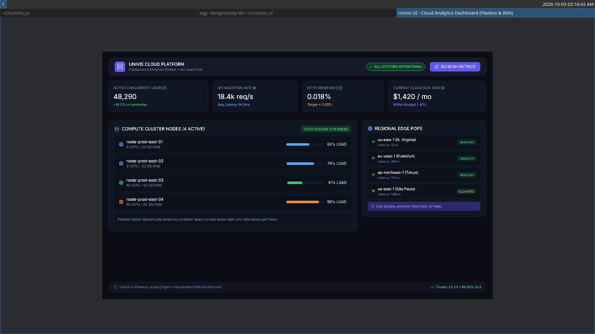

<div align="center">

# Luma

**A high-performance, SDF-based hybrid world-space UI framework for the Bevy game engine.**

[](https://crates.io/crates/bevy_luma)
[](https://docs.rs/bevy_luma)
[](https://bevyengine.org)
[](#license)

<br/>

<p align="center">
  
</p>

</div>

---

> **Developer Handbook**: Looking for copy-paste recipes, layout cheat sheets, or troubleshooting? Check out the [Developer Guide](docs/GUIDE.md).

---

## Features

- **Pure GPU Signed Distance Field (SDF) Rendering**:
  - Pixel-perfect, anti-aliased rounded corners (`UCornerRadius`), dynamic borders (`UBorder`), and box shadows (`UShadow`).
  - Real-time inner and outer holographic glows (`UGlow`) rendered in optimized shader passes.
  - Zero-cost resolution scaling: crisp at 720p, 4K, or in VR headsets.

- **Native Layout Engine (`luma_layout`)**:
  - Independent layout engine written in pure Rust with zero Web engine dependencies.
  - Full support for **Flexbox**, **CSS Grid** (fractional units `Fr`, `Auto`, repeats), **Absolute**, and **Radial** layouts.
  - Dual-buffer topological pass (pass-up for intrinsic measurement, pass-down for bounded positioning) caching in flat arenas with zero runtime allocations.

- **Seamless 2D & 3D Spatial UI**:
  - **Screen Space**: `URootUi::screen()` and `URootUi::virtual_screen(Vec2::new(1920.0, 1080.0))` for deterministic game HUDs.
  - **In-World 3D**: `URootUi::world_3d(Vec2::new(width, height))` for physical terminals, VR panels, and interactive sci-fi kiosks.
  - Unified component model: identical APIs for both 2D and 3D UI.

- **Embedded Multi-Script Typography & Vector Icons**:
  - Embedded high-legibility fonts: Inter, Adwaita Sans, Fira Sans, and FreeSerif.
  - Full Arabic and RTL bidirectional shaping powered by `unicode-bidi` and `swash`.
  - Built-in Lucide vector icon library with over 1,400 icons available out of the box (`Icon::PLAY`, `Icon::SEARCH`, `Icon::SHOPPING_BAG`, etc.).

- **Spatial Focus Navigation & Pointer Interaction**:
  - First-class pointer picking backend (`UInteraction`, `UInteractionColors`).
  - Spatial directional navigation (Tab, Arrow keys, Gamepad D-Pad/sticks) via `UFocusable` and `UFocusVisual`.
  - Interactive text fields with caret animation, clipboard, and input filtering (`UTextInput`).

- **Spring Transitions & Kinetic Momentum**:
  - Configurable spring physics (`UTransition`) for responsive hover, accordion collapses, and scale bumps.
  - Inertial kinetic scrolling containers (`UScrollContainer`) with customizable scrollbars.

---

## The Mental Model

Luma is designed to feel natural and predictable. Every interface follows three building blocks:

```
[Camera2d or Camera3d]
       │
[URootUi] ─── Canvas (Screen HUD, Virtual Resolution, or 3D World Space)
       │
    [UNode] ─── Box (Sizing, Flexbox/Grid, Rounded Corners, Borders, Shadows)
       │
    ├── [UText]  ─── Typography (Latin, Arabic, Serif) and Lucide Icons
    └── [UNode]  ─── Child containers, buttons, cards, scroll views...
```

1. **Always spawn a Camera** (`Camera2d` for screens, `Camera3d` for in-world UI).
2. **Every tree starts with a Root** (`URootUi::screen()` or `URootUi::world_3d(...)`).
3. **Compose with BSN** using the declarative `bsn!` macro.

---

## Quick Start

Add `bevy_luma` to your `Cargo.toml`:

```toml
[dependencies]
bevy = "0.19"
bevy_luma = "0.1.0"
```

### 1. Minimal Setup

```rust
use bevy::prelude::*;
use bevy_luma::prelude::*;

fn main() {
    App::new()
        .add_plugins(DefaultPlugins)
        .add_plugins(LumaPlugin)
        .add_systems(Startup, setup)
        .run();
}

fn setup(mut commands: Commands) {
    commands.spawn(Camera2d);
    commands.spawn_scene(my_ui());
}
```

---

## Practical BSN Examples

### Interactive Button (Hover Feedback & Click Observer)

```rust
fn action_button() -> impl Scene {
    bsn! {
        UNode {
            width: UVal::Px(160.0),
            height: UVal::Px(44.0),
            background_color: Color::srgb(0.20, 0.40, 0.85),
            border_radius: UCornerRadius::all(8.0),
        }
        UInteraction::default()
        UInteractionColors {
            normal: Color::srgb(0.20, 0.40, 0.85),
            hovered: Color::srgb(0.28, 0.50, 0.95),
            pressed: Color::srgb(0.14, 0.25, 0.55),
        }
        ULayout {
            display: UDisplay::Flex,
            justify_content: UJustifyContent::Center,
            align_items: UAlignItems::Center,
        }
        Children [
            (UText {
                text: { "Click Me".to_string() },
                font_size: 15.0,
                color: Color::WHITE,
            })
        ]
        on(|_event: On<Pointer<Click>>| {
            info!("Button clicked!");
        })
    }
}
```

### Centered Modal Dialog Card

```rust
fn modal_dialog() -> impl Scene {
    bsn! {
        URootUi::screen()
        UNode {
            width: UVal::Percent(1.0),
            height: UVal::Percent(1.0),
            background_color: Color::srgba(0.0, 0.0, 0.0, 0.60),
        }
        ULayout {
            display: UDisplay::Flex,
            justify_content: UJustifyContent::Center,
            align_items: UAlignItems::Center,
        }
        Children [
            (
                UNode {
                    width: UVal::Px(380.0),
                    background_color: Color::srgb(0.12, 0.14, 0.20),
                    border_radius: UCornerRadius::all(16.0),
                    padding: USides::all(24.0),
                }
                UBorder {
                    color: Color::srgb(0.25, 0.30, 0.45),
                    width: 1.0,
                    radius: UCornerRadius::all(16.0),
                }
                ULayout {
                    display: UDisplay::Flex,
                    flex_direction: UFlexDirection::Column,
                    gap: 12.0,
                }
                Children [
                    (UText { text: { "Confirm Action".to_string() }, font_size: 18.0, color: Color::WHITE }),
                    (UText { text: { "Are you sure you want to proceed?".to_string() }, font_size: 14.0, color: Color::srgb(0.7, 0.75, 0.85) }),
                ]
            )
        ]
    }
}
```

### Responsive 3-Column CSS Grid

```rust
fn dashboard_grid() -> impl Scene {
    bsn! {
        UNode {
            width: UVal::Percent(1.0),
        }
        ULayout {
            display: UDisplay::Grid,
            grid_template_columns: vec![
                UTrackSize::Fr(1.0),
                UTrackSize::Fr(1.0),
                UTrackSize::Fr(1.0),
            ],
            gap: 16.0,
        }
        Children [
            (grid_item("Analytics")),
            (grid_item("Storage")),
            (grid_item("Security")),
        ]
    }
}
```

### In-World 3D Spatial UI Panel

```rust
fn world_space_panel() -> impl Scene {
    bsn! {
        URootUi::world_3d(Vec2::new(400.0, 240.0))
        Transform::from_xyz(0.0, 1.5, -2.0)
        UNode {
            width: UVal::Px(400.0),
            height: UVal::Px(240.0),
            background_color: Color::srgba(0.08, 0.12, 0.20, 0.90),
            border_radius: UCornerRadius::all(16.0),
            padding: USides::all(20.0),
        }
        UBorder {
            color: Color::srgb(0.2, 0.7, 1.0),
            width: 2.0,
            radius: UCornerRadius::all(16.0),
        }
        Children [
            (UText { text: { "Diegetic Terminal".to_string() }, font_size: 20.0, color: Color::WHITE })
        ]
    }
}
```

---

## Running Examples

### Practical BSN Examples (Short & Focused)

```bash
cargo run --example button     # Interactive button with hover feedback & click handler
cargo run --example modal      # Centered dialog modal card with Confirm / Cancel
cargo run --example counter    # Stateful counter (+/-) with live reactive text updates
cargo run --example grid       # Responsive 3-column CSS Grid layout
cargo run --example world_3d   # In-world 3D spatial interactive UI panel
```

### Comprehensive Showcases

```bash
cargo run --example luma_flex_dashboard         # Cloud Analytics Dashboard
cargo run --example luma_grid_ecommerce          # Nordic Boutique Store
cargo run --example luma_fantasy_rpg_hud         # Fantasy RPG Game HUD
cargo run --example luma_editorial_typography    # Editorial Magazine & Arabic RTL
cargo run --example luma_scroll_social_feed      # Kinetic Momentum Scroll Feed
cargo run --example luma_focus_game_menu         # Gamepad & Keyboard Focus Navigation
```

---

## Workspace Architecture

```
bevy_luma/
├── crates/
│   ├── luma_layout/       # Pure Rust layout engine (Flexbox, CSS Grid, Radial)
│   ├── luma_style/        # Theme palette, embedded typography, Lucide icons
│   ├── luma_engine/       # GPU SDF shaders, settlement loop, bounds solver
│   └── luma_interaction/  # Picking backend, spatial focus, text input fields
├── src/                   # Unified facade crate and prelude
├── examples/              # Practical BSN examples and comprehensive showcases
└── assets/                # Embedded resources and fonts
```

- **`bevy_luma`**: The unified facade crate. Simply add `use bevy_luma::prelude::*;` to access everything.
- **`luma_layout`**: Standalone layout solver with zero Bevy dependencies.
- **`luma_engine`**: The rendering core implementing custom WGSL SDF materials for 2D meshes and 3D in-world geometry.
- **`luma_style`**: Built-in font assets and full Lucide icon set.
- **`luma_interaction`**: Spatial focus algorithms, ray/pointer hit tests, and text caret controllers.

---

## License

Dual-licensed under either:

- MIT License ([LICENSE-MIT](LICENSE-MIT) or [http://opensource.org/licenses/MIT](http://opensource.org/licenses/MIT))
- Apache License, Version 2.0 ([LICENSE-APACHE](LICENSE-APACHE) or [http://www.apache.org/licenses/LICENSE-2.0](http://www.apache.org/licenses/LICENSE-2.0))

at your option.
